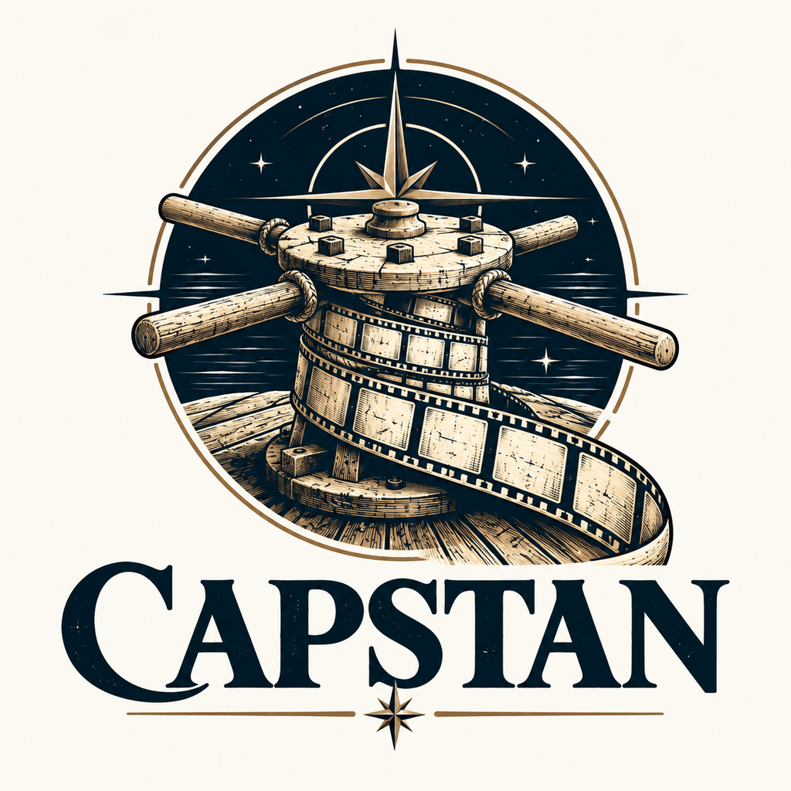
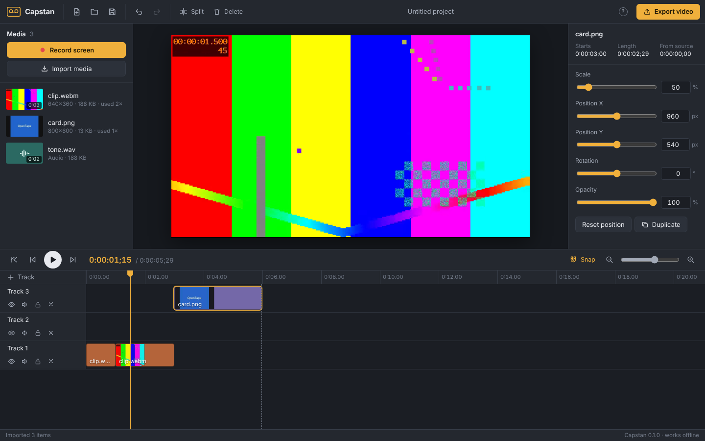

<p align="center"></p>

# Capstan

**An open-source, local-first screen recorder and video editor for Windows.** The goal is a full-featured editor that runs on a locked-down work PC: no installer, no administrator rights, no Node or Python on the machine, no network calls. Record your screen, cut it on a multi-track timeline, and export an MP4, all on your own computer.

The name comes from the capstan: the drum a ship's crew turns to haul in line, and the spinning shaft that pulls tape past the heads in a tape recorder. Capstan was briefly called **OpenTape**; projects saved under that name do not carry over.

**Status: v0.1, foundation.** The editor below works end to end and is covered by automated tests. It is not yet feature-complete; [the roadmap](docs/ROADMAP.md) tracks every planned feature and when it lands. The Windows host is adapted from [SnapShackle](https://github.com/sun-of-anton/SnapShackle)'s tested loopback server, but **this build has not yet been run on a real Windows PC**. Please try it and report back before relying on it.



## Run it on Windows

1. Download or clone the repository and keep the whole folder together, including `dist/` and `modules/`.
2. Double-click **`Capstan.bat`**.
3. Capstan opens in a Microsoft Edge app window (or your default browser if Edge is missing). Keep the console window open while you work; press Ctrl+C there to quit.

Options:

```bat
Capstan.bat -NoBrowser        rem print the address instead of opening a window
Capstan.bat -Port 9000        rem preferred port (default 8790); falls back if busy
Capstan.bat -DefaultBrowser   rem use the default browser instead of an Edge app window
Capstan.bat -Diagnostics      rem check PowerShell, policy, loopback binding and Edge, then exit
```

`Capstan.bat` starts Windows PowerShell 5.1 with `-ExecutionPolicy Bypass` for **that one process only**. It does not change machine or user policy, elevate privileges, or get around Group Policy, AppLocker, WDAC or endpoint protection. If your organisation blocks it, ask IT for an approved route.

Use a current **Edge or Chrome**: Capstan needs WebCodecs (video encoding) and screen capture, which they provide.

## What works in v0.1

| Area | What you can do |
| --- | --- |
| Record | Record a screen, window or tab, with microphone and computer sound mixed together. Pause, resume, stop. The recording lands in the media bin and, optionally, at the end of the timeline. |
| Import | Video (MP4, WebM, MOV and anything else the browser decodes), audio (MP3, WAV, M4A, Ogg, …) and images. Use the button or drop files anywhere in the window. |
| Timeline | Any number of tracks; drag clips between them; trim either edge; split at the playhead (S); delete or ripple-delete (Shift+Delete); duplicate; snapping to clip edges and the playhead; zoom with Ctrl+wheel; hide, mute and lock tracks. |
| Canvas | 1080p, 720p, 1440p, 4K, vertical or square; 24–60 fps; background colour. Click a clip in the preview to select it, drag to move it (snaps to the centre), drag the corner to resize. |
| Clip properties | Position, scale, rotation, opacity, volume. Picture-in-picture is just a smaller clip on a higher track. |
| Playback | Play, pause, frame step, jump to start or end. Press ? for every shortcut. |
| Undo | Unlimited undo and redo within a session (Ctrl+Z, Ctrl+Y). |
| Saving | Projects and media autosave inside the browser on this computer and come back when you reopen Capstan. **Save project file** writes an `.capstan` file of the edit (media stays in Capstan). |
| Export | MP4 with H.264 video and AAC audio (Opus where the browser cannot encode AAC). Same size as the project, 1080p or 720p, at three quality levels. Frame-accurate: every frame is rendered with the same compositor as the preview. |

## Known limitations in v0.1

- **Media lives in the browser's storage for this address.** If port 8790 is taken and Capstan falls back to another port, your earlier projects will not show until it runs on 8790 again (the console says so). Moving the library to files on disk is the first item on the roadmap.
- Export renders and seeks frame by frame, so it is slower than it will be once the roadmap's WASM demuxer lands, and it holds the finished file in memory, so very long exports need plenty of RAM. Streaming export to disk is on the roadmap.
- No annotations, transitions, animations, cursor effects, captions or audio effects yet. See [the roadmap](docs/ROADMAP.md).
- The record button uses the browser's screen-capture picker. Global hotkeys, region capture and cursor data come with the native recorder.

## Privacy and security

- The host listens on `127.0.0.1` only, checks the `Host`, `Origin` and `Sec-Fetch-Site` headers, serves a fixed allowlist of compiled files, and sends a strict Content-Security-Policy (no inline script, no remote anything).
- Recording, editing and export happen in the browser. Media is never uploaded; Capstan makes no network requests.
- This is a single-user local tool. It is not a security boundary against other programs already running as you.

## Building (maintainers, off the workstation)

The Windows machine only runs the compiled `dist/`. To change Capstan, build on a development machine:

```sh
npm install              # React, TypeScript, Playwright (dev only)
bun run build            # bundles src/ into dist/ (commit dist/ with your change)
npm run typecheck
bun test tests/unit      # engine, MP4, host and "dist is up to date" checks
node tests/serve.mjs &   # test server that mirrors the PowerShell host
npm run test:e2e         # headless Chromium: export validated with ffprobe, editor driven end to end
```

See [TechStack.md](TechStack.md) for how the shared stack applies and [docs/ARCHITECTURE.md](docs/ARCHITECTURE.md) for how the pieces fit.

## License

MIT. See [LICENSE](LICENSE).
