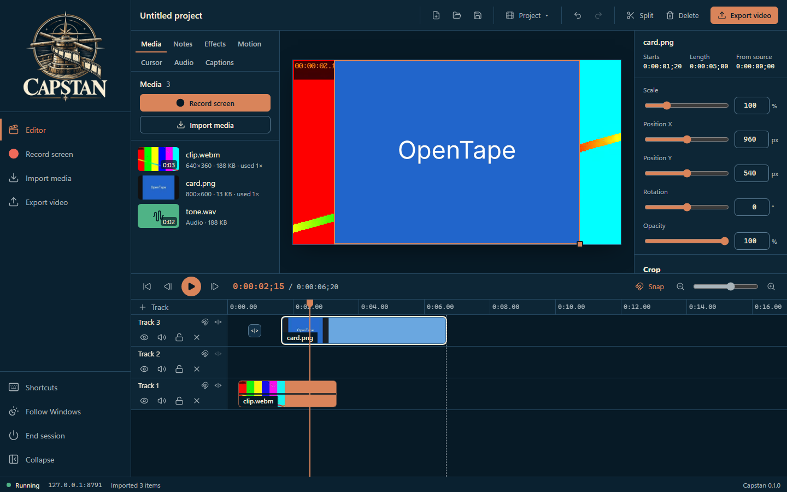
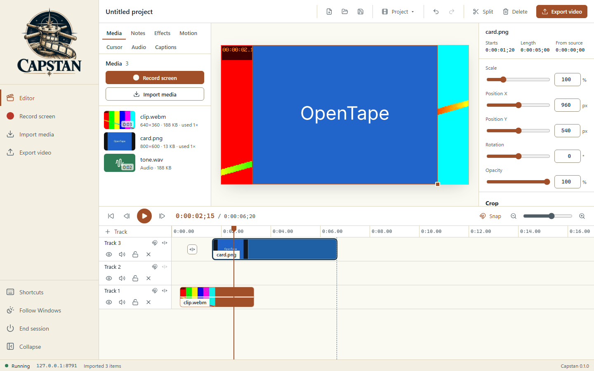

<p align="center">
  <picture>
    <source media="(prefers-color-scheme: dark)" srcset="assets/brand/emblem-dark.png">
    
  </picture>
</p>

# Capstan

**An open-source, local-first screen recorder and video editor for Windows.** The goal is a full-featured editor that runs on a locked-down work PC: no installer, no administrator rights, no Node or Python on the machine, no network calls. Record your screen, cut it on a multi-track timeline, and export an MP4, all on your own computer.

## The name

A *capstan* is the drum on a ship's deck that the crew walks around to haul in a heavy line, turning steady effort into steady pull. In a tape recorder, the capstan is the spinning shaft that pulls the tape past the heads at an exact speed. Capstan does both jobs for your screen: it hauls in what you record, and it runs your footage through the timeline at an even pace to a finished video. Capstan was briefly called **OpenTape**; projects saved under that name do not carry over.

**Status: v0.1, growing toward feature parity.** The editor below works end to end and is covered by automated tests. [The roadmap](docs/ROADMAP.md) tracks every planned feature: most rows are done, the rest are marked partial or planned, and the notes in each row say what is missing. The Windows host is adapted from [SnapShackle](https://github.com/fleethacker-data-crucible/SnapShackle)'s tested loopback server and passes its Windows PowerShell 5.1 tests on the build PC. Please report anything that misbehaves before relying on it.

The interface follows the Fleet Unified UI ([docs/UNIFIED-UI.md](docs/UNIFIED-UI.md)): Night watch and Chart room themes that follow Windows (switch in the sidebar), a collapsible sidebar, and a status bar with the engine state and address.

| Night watch (dark) | Chart room (light) |
| --- | --- |
|  |  |

## Run it on Windows

1. Download or clone the repository and keep the whole folder together, including `dist/` and `modules/`.
2. Double-click **`Launch-Capstan.bat`**.
3. Capstan opens in a Microsoft Edge app window (or your default browser if Edge is missing). Keep the console window open while you work.

**Quitting.** Close the Capstan window and the local server stops by itself a few seconds later (a reload does not stop it, and with several Capstan windows open it waits for the last one). It waits while an export or recording is still running in an open window. You can also click **End session** in the sidebar, press Ctrl+C in the console, or run `Stop-Capstan.ps1`, which finds and stops every running Capstan without needing a process ID. Starting Capstan while it is already running asks whether to stop the old one and start fresh.

Options:

```bat
Launch-Capstan.bat -NoBrowser        rem print the address instead of opening a window
Launch-Capstan.bat -Port 9000        rem preferred port (default 8790); falls back if busy
Launch-Capstan.bat -DefaultBrowser   rem use the default browser instead of an Edge app window
Launch-Capstan.bat -Diagnostics      rem check PowerShell, policy, loopback binding and Edge, then exit
Launch-Capstan.bat --stay            rem keep the server running after the window closes
Launch-Capstan.bat --replace         rem stop a running Capstan and start fresh without asking
```

Set `CAPSTAN_AUTO_STOP=0` in the environment to turn off stopping when the window closes, like `--stay`. While it runs, the host writes `logs\capstan-server-<pid>.json` (process ID, port, address and start time, never the session token) so `Stop-Capstan.ps1` and the launcher can find it; the file is removed when it stops.

`Launch-Capstan.bat` starts Windows PowerShell 5.1 with `-ExecutionPolicy Bypass` for **that one process only**. It does not change machine or user policy, elevate privileges, or get around Group Policy, AppLocker, WDAC or endpoint protection. If your organisation blocks it, ask IT for an approved route.

Use a current **Edge or Chrome**: Capstan needs WebCodecs (video encoding) and screen capture, which they provide.

## What works

| Area | What you can do |
| --- | --- |
| Record | Choose a browser tab, a window or the entire screen. For a tab or window, screens are left out of the browser's picker, and anything else the browser shares is refused before a frame is recorded. Microphone and computer sound mixed, or on separate tracks. Optional webcam as its own picture-in-picture track. Countdown (3 or 5 s), a maximum length, and recording straight to disk so memory stays flat; a recording interrupted by a crash is offered back at the next start. Select a region of the shared screen first and it becomes the clip's crop. Pause, resume, stop. |
| Import | Video (MP4, WebM, MOV and anything else the browser decodes), audio (MP3, WAV, M4A, Ogg, ...) and images. Use the button or drop files anywhere in the window. |
| Timeline | Any number of tracks; drag clips between them; trim either edge; split at the playhead (S); delete or ripple-delete (Shift+Delete); copy, cut, paste, duplicate; drag several clips at once; group clips (G); magnetic tracks and gap removal; snapping; zoom with Ctrl+wheel; hide, mute and lock tracks. Markers (M) on the ruler, written into the MP4 as chapters. Undo and redo (Ctrl+Z, Ctrl+Y). |
| Clip tools | Position, scale, rotation, opacity, volume; crop with handles in the preview; speed from 0.1x to 8x, freeze frame and extend frame; detach the audio from a video. |
| Annotations | Text, callouts, arrows, lines, shapes, highlight and spotlight, with fonts, colours and style presets. Arrows and shapes can draw themselves on. Blur and pixelate regions hide personal details. All are timed, move and resize in the preview, and appear in a lane under the tracks. |
| Animation | Keyframes with easing on position, scale, rotation and opacity; zoom-n-pan regions; transitions (fade, slide, wipe, zoom, pop); entrance, emphasis and exit presets. |
| Effects | Colour adjustment and tint, green-screen removal, drop shadow, border, rounded corners, circle and ellipse masks, 13 blend modes, and device frames (browser, laptop, phone, tablet, monitor). |
| Cursor | Attach a cursor-data file (`.cursor.json`, [format](docs/cursor-data.md)) to a recording to re-draw the cursor smoothed, highlighted, magnified or spotlit, with click rings and sounds, key callouts and suggested zooms. Capstan cannot capture the cursor itself yet. |
| Audio | Fades and volume points, waveforms on the timeline, noise removal, levelling, and ducking music under narration. Noise removal and levelling are applied to a new audio file. |
| Captions | Import SRT or WebVTT, edit them in a list and a timeline lane, burn them into the export, and save SRT or WebVTT. |
| Export | MP4 (H.264 with AAC, or Opus where AAC is unavailable), animated GIF, a PNG of one frame, and WAV or M4A audio only. Export the whole timeline or just the part between the I and O marks. Saved presets and a batch queue. Save straight to a file as it renders so long exports do not fill memory. Every frame is rendered with the same compositor as the preview; if the hardware video encoder stops responding, the export carries on with the software encoder. |
| Projects | Projects and media autosave inside the browser on this computer. A project list, templates, a reusable asset library, and **Save package** writes a single `.capstanz` file with the project and its media, which opens on any computer. **Save project file** still writes the small `.capstan` edit-only file. |

Press ? in the editor for every shortcut.

Making a demo video? [docs/DEMO-RECIPE.md](docs/DEMO-RECIPE.md) has the exact steps, from recording to a checked MP4.

## Known limitations

- **Media lives in the browser's storage for this address.** If port 8790 is taken and Capstan falls back to another port, your earlier projects will not show until it runs on 8790 again (the console says so). Use **Save package** to move a project between ports or computers. Moving the library to files on disk needs host support that is not built yet.
- **No cursor or keyboard capture.** A browser cannot read the cursor or keys while it records another app, so the cursor effects need a data file from a tool that can. Global hotkeys and a tray icon, which need the same host support, are not built either.
- **No speech-to-text and no background removal.** Both need a model or a Windows service the host does not provide yet.
- Where the browser's H.264 recorder writes nothing for screen capture (seen in Edge with some hardware encoders), Capstan records WebM instead, after a two-second check when you press Start.
- Two touching clips on one track fade through the background instead of cross-dissolving; put them on two tracks for a true dissolve.
- Fast video decoding covers H.264 in MP4 and VP8 or VP9 in WebM; other sources fall back to seeking, which is slower.
- The editor command registry is described in [docs/CLI.md](docs/CLI.md). `Capstan-CLI.bat` is not built. The Fleet action CLI is [capstan.ps1](capstan.ps1) ([docs/CLI-API.md](docs/CLI-API.md)): `commands --json` lists every action, and `help --json` is the same list.

## Privacy and security

- The host listens on `127.0.0.1` only, checks the `Host`, `Origin` and `Sec-Fetch-Site` headers, serves a fixed allowlist of compiled files, and sends a strict Content-Security-Policy (no inline script, no remote anything).
- Recording, editing and export happen in the browser. Media is never uploaded; Capstan makes no network requests.
- This is a single-user local tool. It is not a security boundary against other programs already running as you.

## Building (maintainers, off the workstation)

The Windows machine only runs the compiled `dist/`. To change Capstan, build on a development machine:

```sh
npm install              # React, TypeScript, Playwright (dev only)
bun run build            # bundles src/ into dist/ (commit dist/ with your change); on Windows it stops a running Capstan first
npm run typecheck
bun test tests/unit      # engine, MP4, host and "dist is up to date" checks
npm run test:e2e         # headless Chromium on a free port: exports validated with ffprobe, every area driven end to end
node tests/e2e/run-all.mjs captions   # or only the e2e files whose name contains "captions"
```

On Windows, `powershell -ExecutionPolicy Bypass -File tests\ps\Lifecycle.Tests.ps1` checks the real host's lifecycle (CI runs it on `windows-latest`).

See [TechStack.md](TechStack.md) for how the shared stack applies and [docs/ARCHITECTURE.md](docs/ARCHITECTURE.md) for how the pieces fit.

## License

MIT. See [LICENSE](LICENSE).
