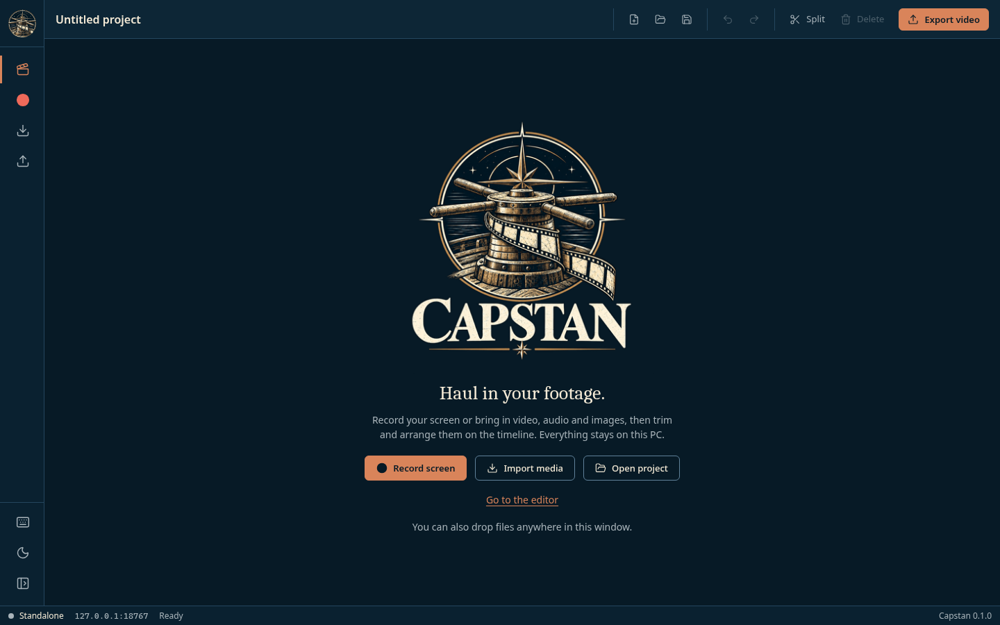
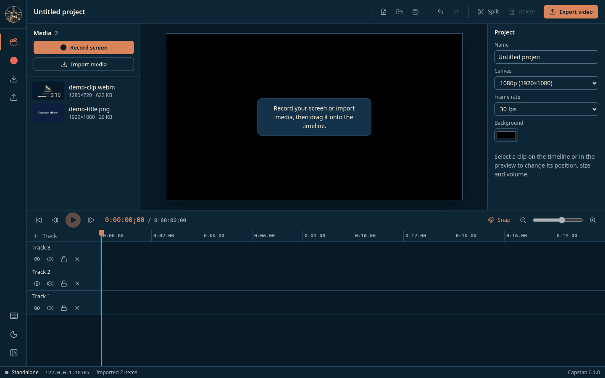
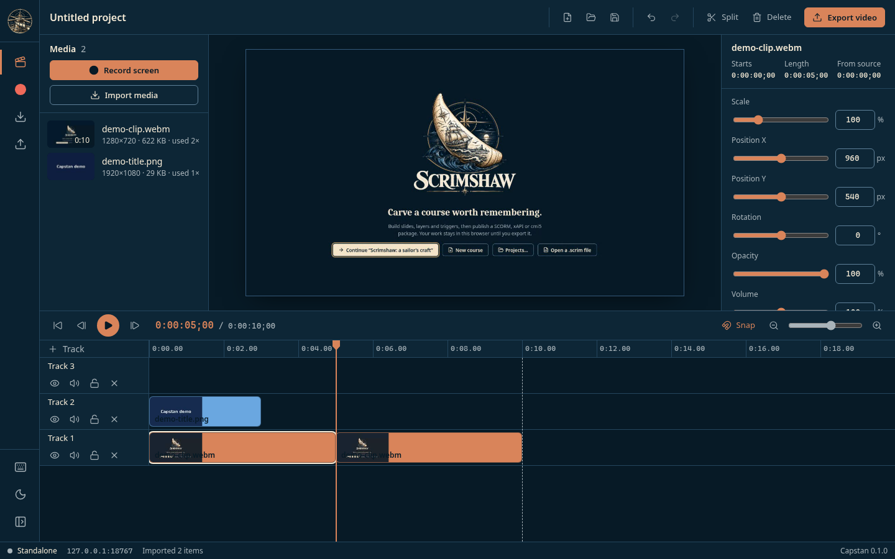
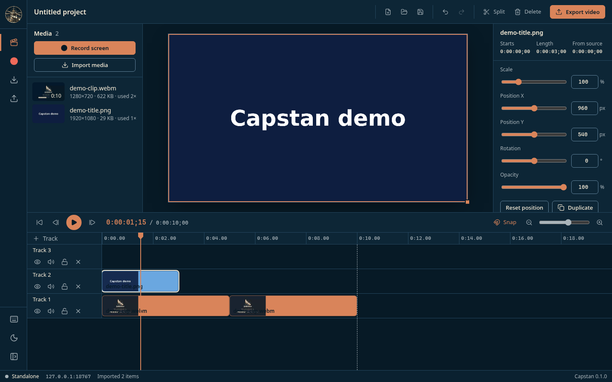
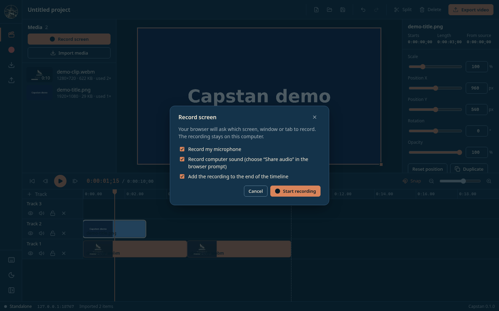
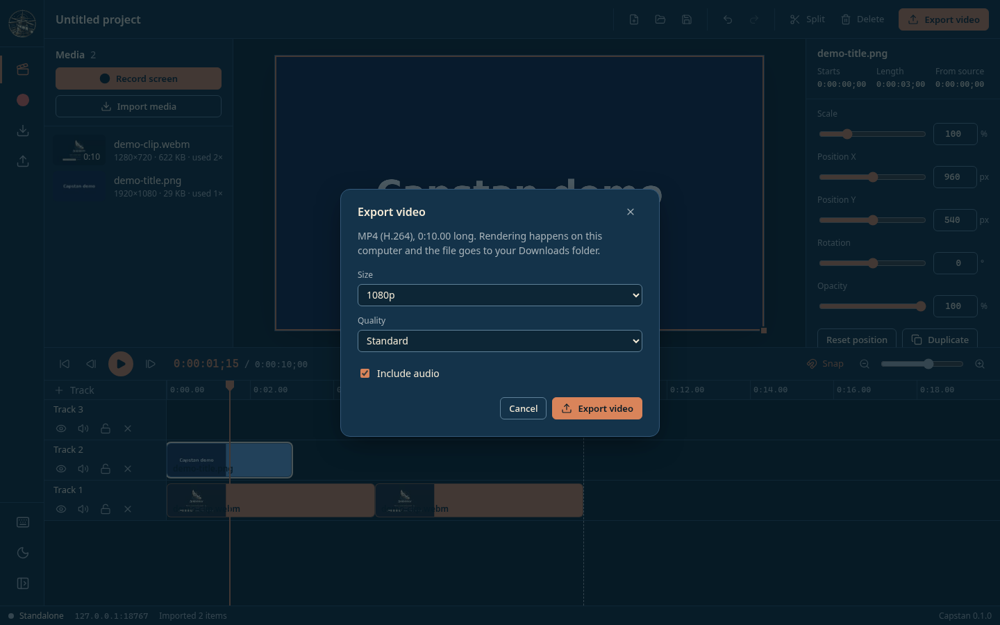

# Capstan walkthrough

Record or import footage, cut it on a multi-track timeline and export an MP4, all on this computer.

> **Screenshots:** captured with demo data and scanned by the Chief of Staff (team directive 10).

## Before you start

- Windows PowerShell 5.1 (part of Windows). No administrator rights and no installer.
- Microsoft Edge or Google Chrome.
- Launch: Double-click `Launch-Capstan.bat` (opens an Edge app window on `127.0.0.1`, port 8790 or the next free one).
- Microsoft Edge, or Chrome with `-DefaultBrowser`.

## Steps

### 1. First launch

Capstan opens on its welcome screen, *Haul in your footage*.

### 2. Import media

Select **Import media**, or drop files anywhere in the window. They land in the media bin.

### 3. Edit on the timeline

Drag clips onto tracks, trim their edges and press **S** to split at the playhead. The demo clip used here is a short recording of Scrimshaw's welcome screen.

### 4. Adjust a clip

Select a clip. The **Inspector** sets its position, scale, rotation, opacity and, for clips with sound, volume. Here the playhead is at 0:00:01;15, over the title card.

### 5. Record your screen

**Record screen** asks your browser which screen, window or tab to record, with options for the microphone, computer sound and adding the recording to the end of the timeline.

### 6. Export

**Export video** writes an MP4 (H.264) to your Downloads folder. Choose the size and quality, and whether to include audio.

## About these images

Images live in [`docs/assets/walkthrough/`](../assets/walkthrough/), named `NN-<screen>.png` after the step they belong to. They are 1440x900 at 100% scale in the Night watch (dark) theme, and show demo data only.
