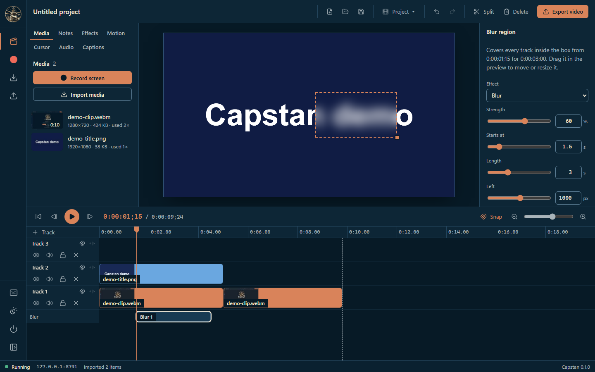
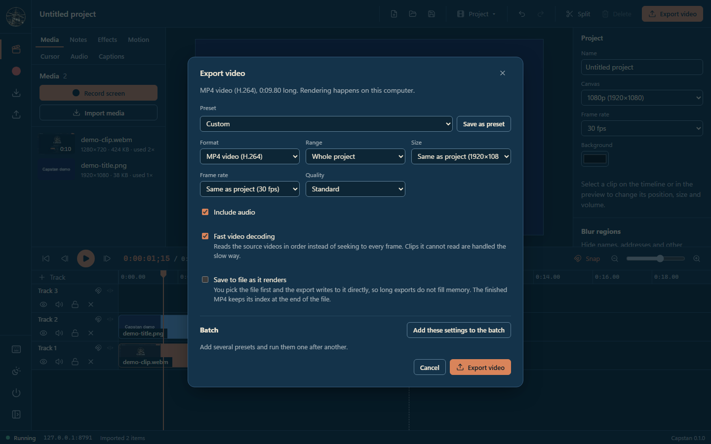
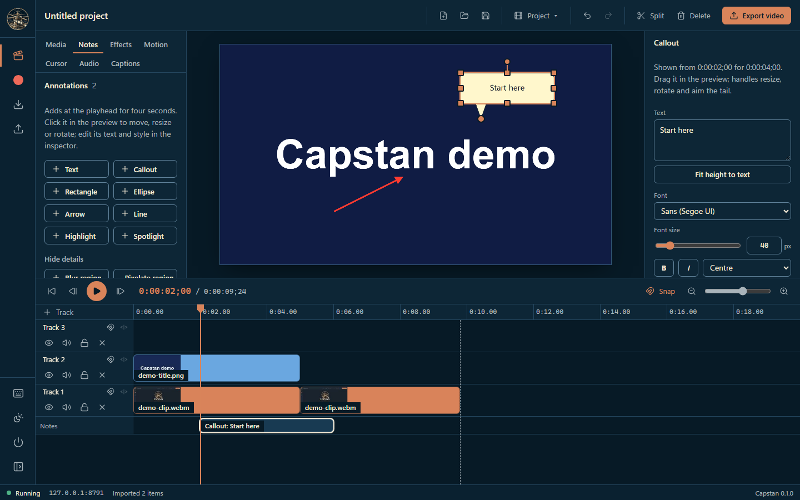
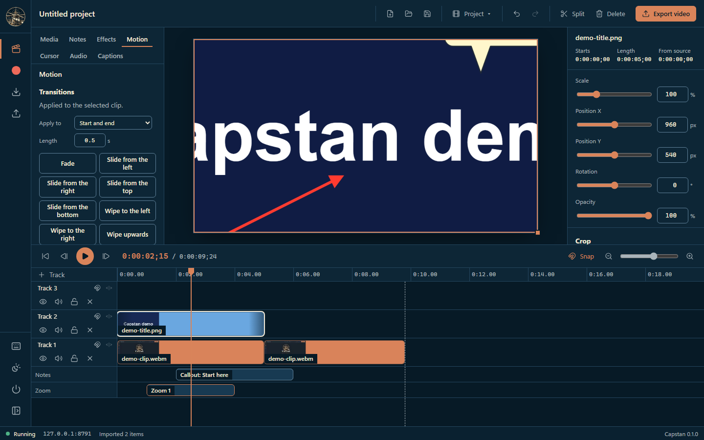
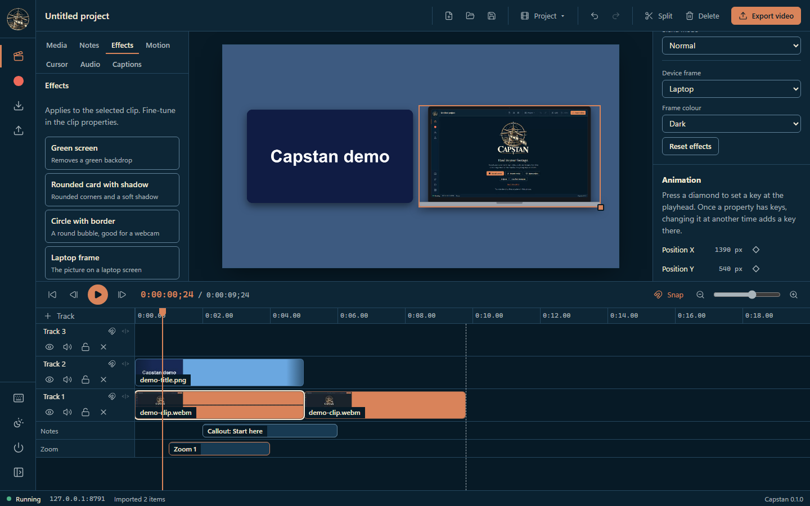
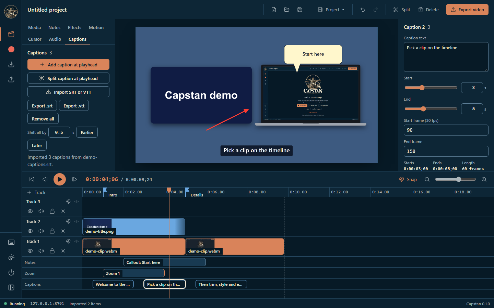
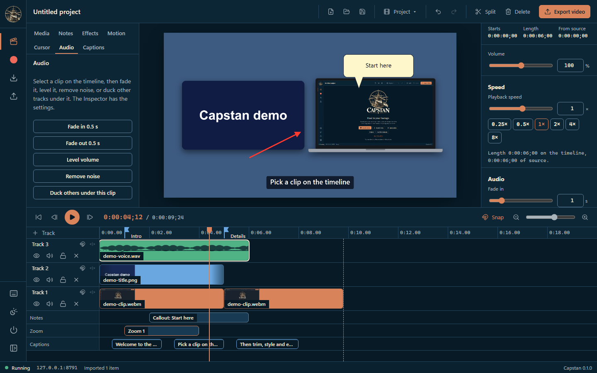
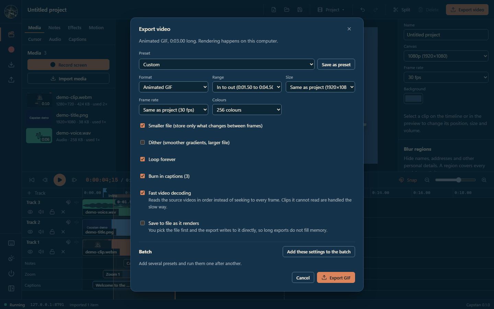

# Capstan walkthrough

Record or import footage, cut it on a multi-track timeline, add notes, motion, effects, captions and audio, and export a video, GIF or audio file, all on this computer.

> **Screenshots:** captured with demo data and scanned by the Chief of Staff (team directive 10).

## Before you start

- Windows PowerShell 5.1 (part of Windows). No administrator rights and no installer.
- Microsoft Edge or Google Chrome.
- Launch: Double-click `Launch-Capstan.bat` (opens an Edge app window on `127.0.0.1`, port 8790 or the next free one).
- Microsoft Edge, or Chrome with `-DefaultBrowser`.

## Steps

### 1. First launch

Capstan opens on its welcome screen, *Haul in your footage*.

### 2. Import media

Select **Import media**, or drop files anywhere in the window. They land in the media bin.

### 3. Edit on the timeline

Drag clips onto tracks, trim their edges and press **S** to split at the playhead. The demo clip used here is a short recording of Capstan's own welcome screen.

### 4. Adjust a clip

Select a clip. The **Inspector** sets its position, scale, rotation, opacity and, for clips with sound, volume, and goes on to crop, speed, effects and keyframes. Here the playhead is at 0:00:01;15, over the title card.

### 5. Record your screen

**Record screen** first asks what to record: a browser tab, a window or the entire screen. For a tab or a window, your browser's picker does not offer screens, and if anything else is shared Capstan stops before recording a frame. Options cover the microphone, computer sound, a webcam on its own track, a countdown, saving to disk while recording and adding the recording to the end of the timeline.

### 6. Blur personal details

With no clip selected, the Inspector lists **Blur regions**; the **Notes** tab has the same blur and a pixelate region. **Add blur region at playhead** puts a box over every track for three seconds; drag it in the preview, resize it from the corner, and set blur or pixelate, the strength and the timing.

### 7. Export

**Export video** opens the export dialog. Pick a preset or set the format, range, size, frame rate and quality yourself, choose whether to include audio and, when the project has captions, whether to burn them in. An MP4 (H.264) is written to your Downloads folder, or straight to a file you choose.

### 8. Add callouts and arrows

Open the **Notes** tab to add text, callouts, shapes, arrows, highlights or a spotlight at the playhead; each gets its own row under the tracks, and the Inspector sets its text, font, colours and timing.

### 9. Zoom, pan and transitions

On the **Motion** tab, **Add zoom at playhead** magnifies part of the picture for a while and zooms back out, and the transition presets fade or slide the selected clip in and out.

### 10. Style a clip with effects

The **Effects** tab applies one-click looks, such as a rounded card with a shadow or a laptop frame, and the Inspector fine-tunes colour, shadow, corners, blend mode and device frame.

### 11. Captions and chapter markers

Add captions or import an SRT or WebVTT file on the **Captions** tab and edit each one in the Inspector, and press **M** to drop a marker on the ruler that can also be a chapter.

### 12. Work with audio

Audio clips draw their waveform on the timeline, the **Audio** tab offers quick fades, levelling and noise removal, and the Inspector sets the volume and fade lengths.

### 13. Export a part, or another format

Mark a range with **I** and **O** on the timeline, then choose it under Range, and pick another format such as an animated GIF, a PNG of one frame, or WAV or M4A audio only.

## About these images

Images live in [`docs/assets/walkthrough/`](../assets/walkthrough/), named `NN-<screen>.png` after the step they belong to. They are 1440x900 at 100% scale in the Night watch (dark) theme, and show demo data only.
